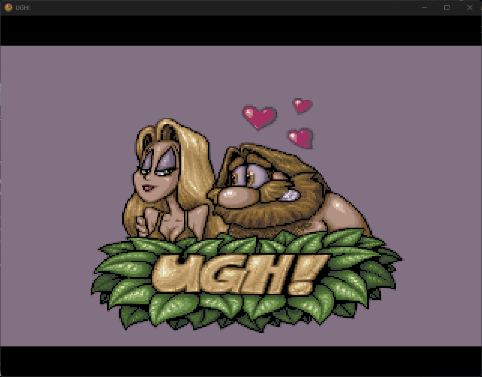

# UGH! 64bit



A native 64-bit Windows version of **UGH!** (Play Byte, 1992), the DOS game in which a caveman flies a
pedal-powered stone-age helicopter as a taxi. It is built from a disassembly and static recompilation
of the original DOS program. The music and sound effects of the **Amiga version** are also included,
and you can switch between the DOS and Amiga sound at any time.

This project contains **no game files**. You need your own copy of the DOS game. To hear the Amiga
sound you also need the Amiga version's disk image.

## What you need

- Windows 10 or 11, 64-bit.
- The DOS game: put `UGH!64.exe` in the folder that holds `UGH.EXE`, or start it and choose that
  folder when asked. You can also give the folder on the command line: `UGH!64.exe C:\Games\UGH`.
- Optional: the Amiga disk image (`.adf`) for the Amiga sound. UGH!64 looks for any `*.adf` in the
  game folder, in an `amiga` folder next to it, in the folder above it and next to `UGH!64.exe`.
  You can also choose it from the window menu with **Sound ▸ Locate Amiga disk…**.

High scores and settings are saved in `%APPDATA%\UGH64`.

## Playing through a launcher

Two launchers can install and start UGH!64 for you. Neither of them contains or downloads the game:
you still need your own copy of the DOS game.

- **[RecompLauncher](https://recomplauncher.com).** Install UGH! 64bit there, pick your game folder
  once (the one that holds `UGH.EXE`) and press Play. It starts `UGH!64.exe "<folder>"`. Scaling,
  full screen and CRT scanlines are settings on the game's page; they are the same settings the
  program keeps in `%APPDATA%\UGH64\UGH64.ini`. The high scores (`UGH!.HI`) are backed up from
  `%APPDATA%\UGH64`. The Amiga disk image is still chosen in the program's own menu.
- **[recomp-launcher](https://github.com/sp00nznet/recomp-launcher)** by sp00nznet. From the next
  tagged version on, the release carries an installer (`UGH64-Installer-windows-x64.exe`) that asks
  for your game folder, downloads the newest release and adds a Play button. Until then, running
  `launcher\setup.ps1 -Game "<folder>"` by hand in a copy of this repository does the same: it
  unpacks the release into `play\` and writes `UGH (recomp).cmd`, which starts the game. Windows only.

## Keys

The game's own keys, as on DOS:

| Key | Action |
|---|---|
| Arrow keys (the grey ones) | fly: Up pedals and lifts, Left/Right, Down |
| Right Ctrl (or keypad 0) | action: pick up and drop the stone |
| W / Z / A / S (or keypad 8 2 4 6) with left Ctrl | the second set of keys (player 2) |
| Esc | menu on the title screen (F1 start, F2 password, F3 difficulty, F4 one player/team, F5 controls); quit a game |
| P | pause |
| Ctrl+Q | quit, from the main screen |

The keys of this version:

| Key | Action |
|---|---|
| **Ctrl+Shift+A** | switch between the DOS (AdLib) and Amiga (TFMX) sound |
| Alt+Enter, F11 | full screen |
| Alt+Space | the window menu: display options (scaling: 4:3, integer (default) or smooth; CRT scanlines, off by default), sound, mute, pause when inactive, restart, About |

An Xbox-style gamepad works as the first player's keys: D-pad or left stick = arrows, A = Up,
B or X = action (right Ctrl), Start = F1, Back = Esc, Y = Enter, LB = F2, RB = P.

## The Amiga sound

The Amiga version plays its music and effects with Chris Hülsbeck's TFMX player. UGH!64 includes a
C translation of the player found on the Amiga disk (`TFMX.obj`) and emulates the four Paula sound
channels. It reads the tunes and samples (`mdat.UGH!-All_Sounds.o`, `smpl.UGH!-All_Sounds`) from your
disk image. The tunes follow the DOS game: the title tune, the level-start jingle, each level's own
in-game tune at the volume the Amiga game uses, game over, and high score. The Amiga version's sound
effects play at the matching game events.

## Building

You need Visual Studio 2022 or later (C/C++ for x64) and, to regenerate the recompiled code, Python 3
with `capstone`.

```
build.cmd           the game and the headless test program
build.cmd game      build\UGH!64.exe
build.cmd test      build\ughtest.exe (runs the game without a window, for tests)
package.cmd         dist\UGH!64-1.0-win64.zip
```

The zip holds `UGH!64.exe`, `README.md`, `LICENSE.txt` and `recomplauncher.json`, the file
RecompLauncher reads to install and start the program.

`src\gen\gen_all.c` (the recompiled code) is generated from your own copy of the game by
`tools\ughrec.py`, and it is not part of the public sources. Without it, the build uses the
interpreter only, which runs the same game a little slower:

```
set UGH_DUMPIMG=work\unpacked\ugh.img
build\ughtest.exe C:\Games\UGH 100
python tools\ughrec.py           (writes src\gen\gen_all.c)
```

`build.cmd private` makes `build\private\UGH!64.exe` with the game files (and the Amiga disk, if
found in `_references\amiga`) inside it. That program contains the game: keep it for your own use
and never share it.

## Legal

The port's own code is under the MIT license (see `LICENSE`). UGH! and its programs, music, graphics
and data belong to their owners and are not part of this software. The YM3812 (AdLib) emulation and
the CRT scanlines filter come from the author's Civ64 project.

<a href="https://recomplauncher.com"><picture><source media="(prefers-color-scheme: dark)" srcset="https://recomplauncher.com/assets/press/launcher/badge-light.svg"></picture></a> [](https://recompstore.com/dev/buyukcaglar)
